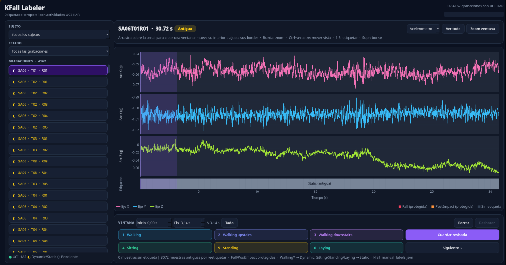

# KFall Labeler

Interfaz grafica PyQt6/pyqtgraph para etiquetar manualmente las grabaciones de
KFall con las actividades de UCI HAR.

```text
kfall_labeler/
├── label_kfall_manual.py   # lanzador (linea de comandos)
├── gui.py                  # ventana PyQt6/pyqtgraph
├── editor.py               # modelo de etiquetas y guardado seguro del JSON
├── requirements.txt        # dependencias de la GUI
├── dataset/                # copia local de KFall (ver dataset/README.md)
└── tests/                  # pruebas del modelo y de la interfaz
```

La herramienta reutiliza los cargadores del repositorio (`loaders/`,
`preprocess/`, `labeling/kfall_manual_labels.py`), por eso debe quedar dentro
de la raiz de `Neuromorphic-HAR`.

## Instalacion

```bash
python -m venv .venv
.venv/bin/python -m pip install -r kfall_labeler/requirements.txt
```

Despues descarga KFall siguiendo [`dataset/README.md`](dataset/README.md).

## Uso

Desde la raiz del repositorio:

```bash
.venv/bin/python kfall_labeler/label_kfall_manual.py
# equivalente:
.venv/bin/python -m kfall_labeler
```

Por defecto se abre `kfall_labeler/dataset/KFall`. Si no existe, se usa
`data/KFall`. Las etiquetas se guardan en `annotations/kfall_manual_labels.json`,
que `train_kfall.py` usa automaticamente.

| Opcion | Uso |
|---|---|
| `--dataset-root PATH` | Carpeta KFall con `sensor_data/` y `label_data/`. |
| `--label-dir PATH` | Carpeta alternativa de los XLSX oficiales. |
| `--output PATH` | Otro JSON de etiquetas (`--annotation-file PATH` al entrenar). |
| `--exclude-tasks T05 ...` | Tareas ocultas; sin valores muestra todas. |
| `--save-frame PNG` | Exporta una captura sin abrir la ventana y termina. |

Las exclusiones por defecto son las de entrenamiento: `T05 T13 T14 T16 T18 T19`.
Para excluir tambien T15, usa la misma lista en el editor, la calibracion y el
entrenamiento:

```bash
.venv/bin/python kfall_labeler/label_kfall_manual.py --exclude-tasks T05 T13 T14 T15 T16 T18 T19
```

Las exclusiones solo ocultan grabaciones; sus etiquetas existentes se conservan.

## Interfaz



- **Izquierda:** filtros por sujeto y por estado (todas o solo pendientes), y la
  lista de grabaciones. Cada grabacion se marca como UCI HAR (●), antigua
  Dynamic/Static (◐) o pendiente (○).
- **Derecha:** graficos X, Y y Z sincronizados mas una linea de etiquetas. El
  selector cambia entre acelerometro (g) y giroscopio (deg/s).
- **Ventana temporal:** arrastra sobre la senal para crearla. Arrastra su
  interior para moverla y sus bordes para cambiar su duracion. Tambien puedes
  ajustar inicio y fin con los campos numericos.
- **Vista:** rueda para zoom, Ctrl+arrastre para desplazarte, **Zoom ventana** y
  **Ver todo**.

| Tecla | Accion |
|---|---|
| `1` | WALKING |
| `2` | WALKING_UPSTAIRS |
| `3` | WALKING_DOWNSTAIRS |
| `4` | SITTING |
| `5` | STANDING |
| `6` | LAYING |
| `Supr` | Borrar la etiqueta de la seleccion |
| `Ctrl+Z` | Deshacer |
| `Ctrl+S` | Guardar como revisada |

Los intervalos Fall y PostImpact salen de los XLSX oficiales, con las mismas
reglas del entrenamiento, y no se pueden modificar. Las muestras normales sin
etiqueta empiezan sin asignar.

## Formato guardado y entrenamiento

Cada grabacion guarda:

- `activity_intervals`: `[frame_inicio, frame_fin_exclusivo, actividad]`, con
  la actividad UCI HAR en base 0, como en `preprocess_ucihar.ACTIVITY_LABELS`.
- `intervals`: la equivalencia usada por el entrenamiento actual de KFall. Las
  tres actividades de caminar son `Dynamic=1`; SITTING, STANDING y LAYING son
  `Static=2`.

Las etiquetas antiguas Dynamic/Static se muestran como "antiguas" y siguen en
el filtro de pendientes hasta reetiquetarlas con UCI HAR y guardarlas.

El guardado es atomico. Si solo existe `kfall_manual_labels.json.bak`, se carga
y no se modifica; en cada guardado la version anterior queda en `.json.previous`.
El editor no sobrescribe un archivo modificado por fuera, pide confirmacion
ante cambios sin guardar y avisa si una grabacion queda etiquetada solo en
parte. Los extremos sin etiqueta se excluyen del entrenamiento.

Usa el editor sobre los sujetos de entrenamiento. No corrijas etiquetas de
validacion o test a partir de las predicciones del modelo.

## Pruebas

```bash
QT_QPA_PLATFORM=offscreen .venv/bin/python -m unittest discover -s kfall_labeler/tests -v
```
